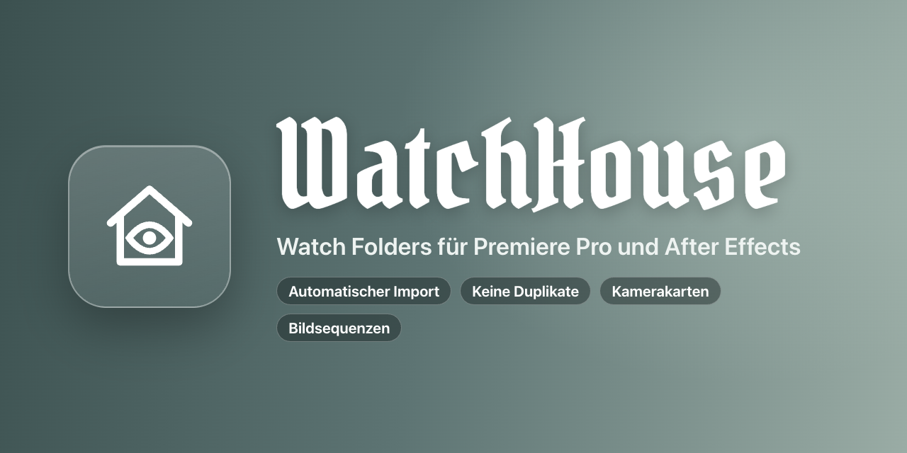
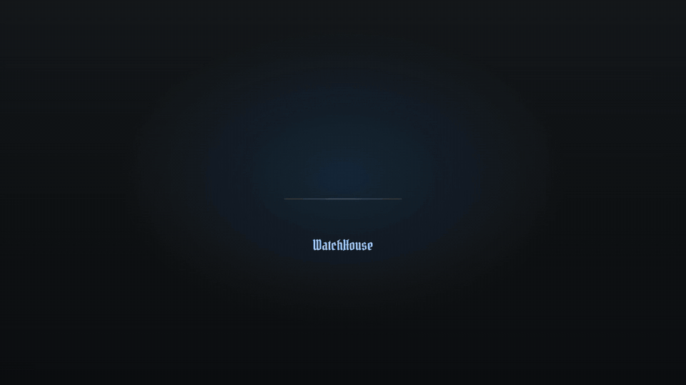
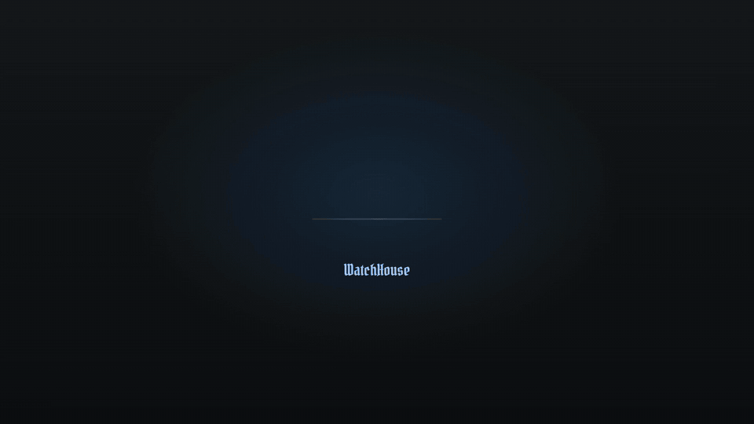
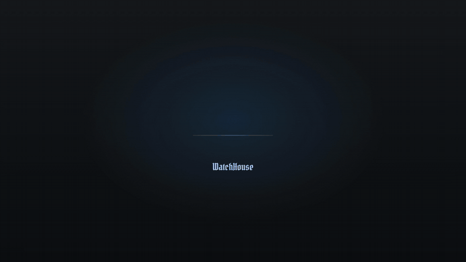
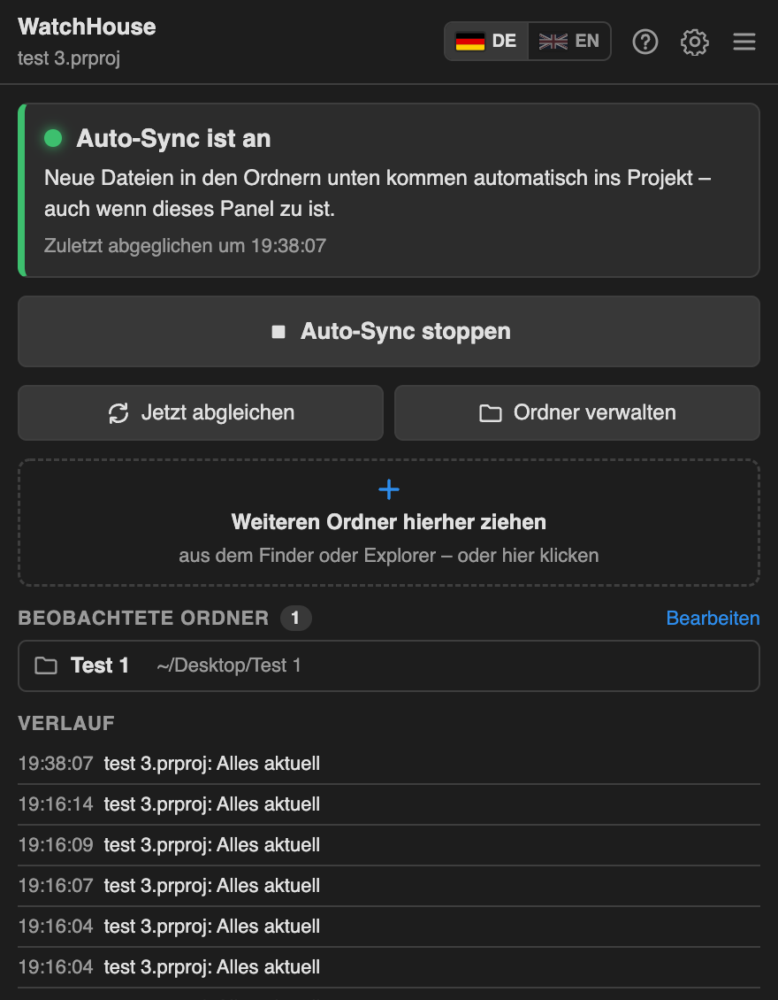
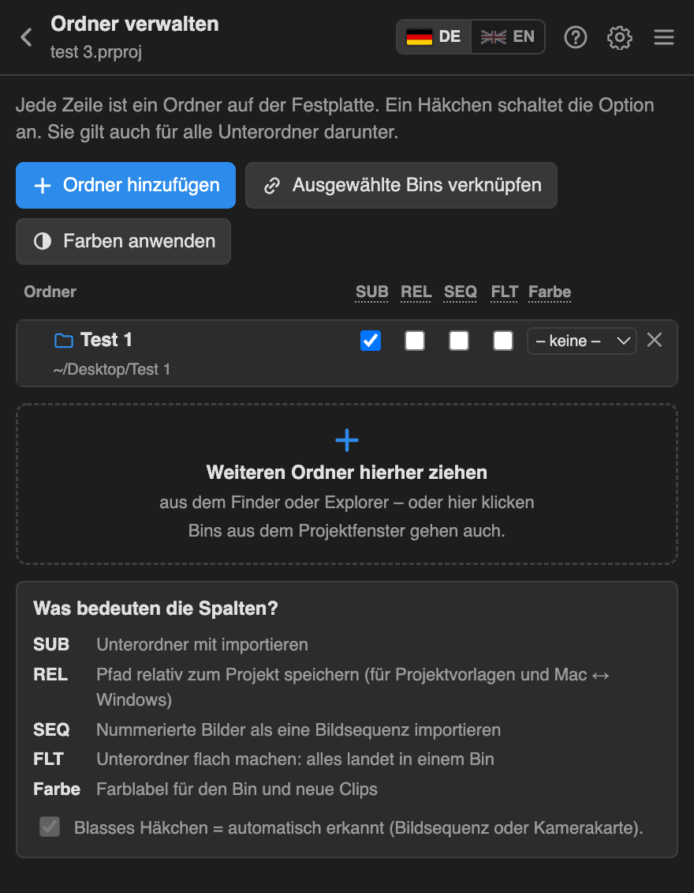
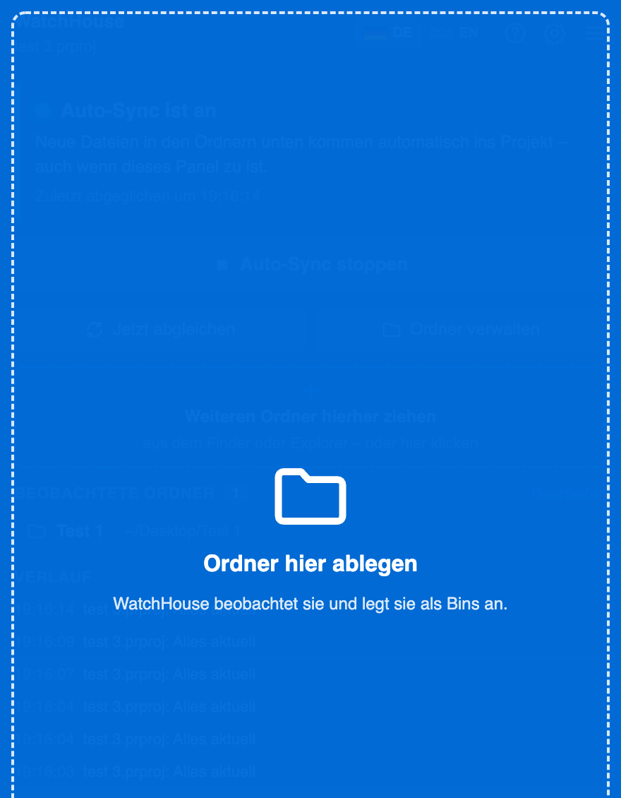
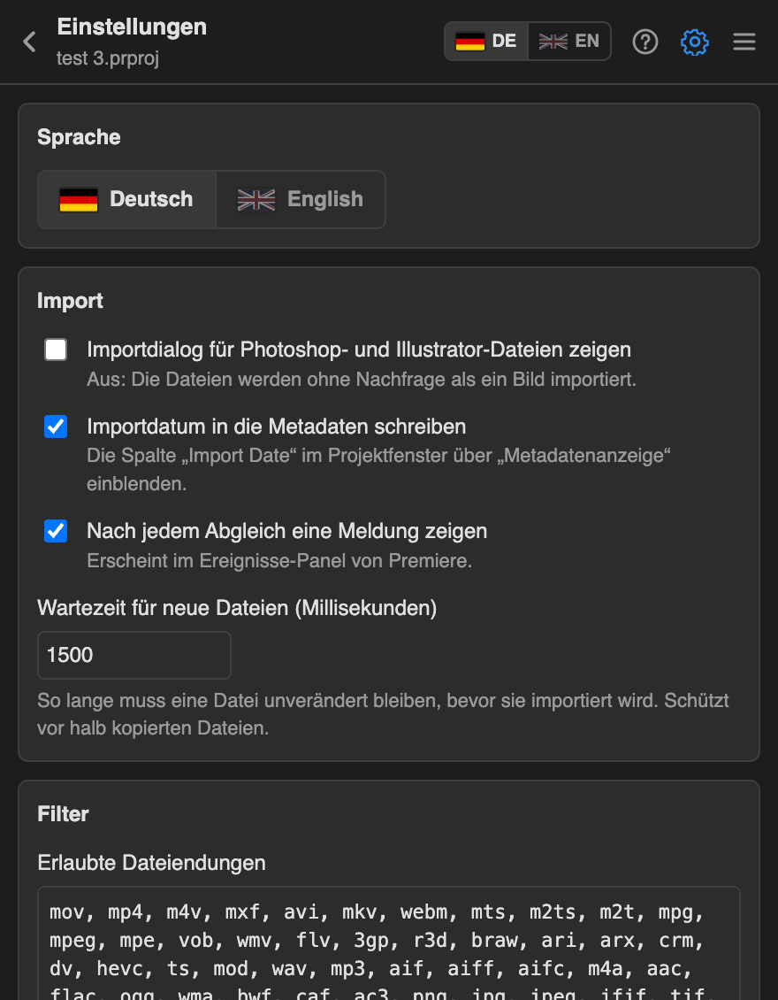
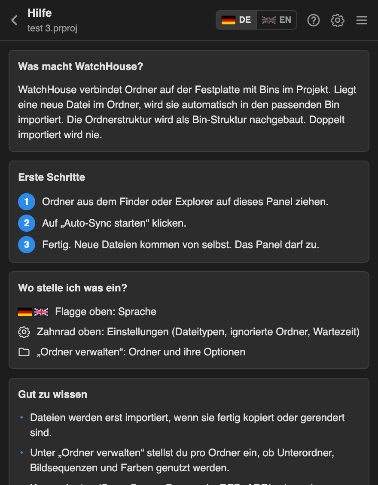

<p align="center">
  
</p>

<p align="center">
  Watch Folders für Premiere Pro und After Effects.<br>
  Datei in den Ordner legen – sie landet im Projekt, im richtigen Bin.
</p>

<p align="center">
  <a href="README.md">English</a> · <b>Deutsch</b>
</p>

<p align="center">
  <a href="https://github.com/Richard2007-21/WatchHouse/releases/latest/download/WatchHouse.zip"><b>Download</b></a>
  &nbsp;·&nbsp;
  <a href="https://github.com/Richard2007-21/WatchHouse/releases">Alle Versionen</a>
  &nbsp;·&nbsp;
  <a href="CHANGELOG.md">Änderungen</a>
</p>

<p align="center">
  
  
  
  
  
</p>

<p align="center">
  
</p>

## So funktioniert es

1. **Ordner verbinden.** Einen Ordner aus dem Finder oder Explorer auf das WatchHouse-Panel ziehen.
2. **Auto-Sync läuft.** Es startet von selbst, sobald du einen Ordner hinzufügst.
3. **Fertig.** Neue Dateien landen im passenden Bin, neue Unterordner werden zu Bins. Nichts wird doppelt importiert. Das Panel darf zu – WatchHouse beobachtet im Hintergrund weiter.

<p align="center">
  
</p>

WatchHouse wartet, bis eine Datei fertig kopiert oder gerendert ist, und Bildsequenzen wachsen im Projekt mit, während sie rendern:

<p align="center">
  
</p>

Kamerakarten werden erkannt. Nur die Clips kommen ins Projekt, flach in einen Bin:

<p align="center">
  
</p>

## Bildschirmfotos

| Hauptansicht | Ordner verwalten | Ordner hineinziehen |
|---|---|---|
|  |  |  |

<details>
<summary>Einstellungen und Hilfe</summary>

| Einstellungen | Hilfe |
|---|---|
|  |  |

</details>

## Installation

### macOS

1. [**WatchHouse.zip**](https://github.com/Richard2007-21/WatchHouse/releases/latest/download/WatchHouse.zip) herunterladen und entpacken.
2. **Install WatchHouse.command** doppelklicken.
   Meldet macOS einen „nicht verifizierten Entwickler“: Datei mit Rechtsklick anklicken, **Öffnen** wählen, dann noch einmal **Öffnen**.
3. Premiere Pro oder After Effects neu starten.
4. **Fenster › Erweiterungen › WatchHouse** öffnen.

Lieber im Terminal? Im entpackten Ordner:

```bash
bash scripts/install-mac.sh
```

### Windows

1. [**WatchHouse.zip**](https://github.com/Richard2007-21/WatchHouse/releases/latest/download/WatchHouse.zip) herunterladen und entpacken.
2. **scripts\install-windows.cmd** doppelklicken.
3. Premiere Pro oder After Effects neu starten.
4. **Fenster › Erweiterungen › WatchHouse** öffnen.

> [!NOTE]
> **Warum ein Installationsskript?** WatchHouse ist kostenlos und nicht über Adobes kostenpflichtiges Programm signiert. Adobe-Programme laden unsignierte Erweiterungen nur, wenn die Einstellung `PlayerDebugMode` an ist. Das Skript schaltet sie ein und kopiert WatchHouse in den Erweiterungsordner von Adobe:
> macOS `~/Library/Application Support/Adobe/CEP/extensions/WatchHouse`,
> Windows `%APPDATA%\Adobe\CEP\extensions\WatchHouse`.

### Deinstallieren

- macOS: `bash scripts/uninstall-mac.sh`
- Windows: Ordner `%APPDATA%\Adobe\CEP\extensions\WatchHouse` löschen

Die Einstellungen deiner Projekte bleiben erhalten.

### Updates

Ab Version 1.4.0 schaut WatchHouse hier auf GitHub nach einer neuen Version (höchstens alle 6 Stunden). Gibt es eine, erscheint oben im Panel ein Banner:

- **Jetzt aktualisieren** lädt `WatchHouse.zip` der neuen Version und ersetzt die Dateien der Erweiterung. Danach Premiere Pro / After Effects neu starten.
- **Neuerungen** zeigt, was sich geändert hat.
- Bei einer Installation aus einem Git-Ordner (`install-mac.sh --link`) oder in einen schreibgeschützten Ordner gibt es stattdessen einen Knopf **Herunterladen**.

Ausschalten oder von Hand prüfen: **Einstellungen › Updates**. Versionen vor 1.4.0 haben keine Update-Prüfung: 1.4.0 einmal von Hand installieren.

## Bedienung

**Oben im Panel**

| | |
|---|---|
| 🇩🇪 DE / 🇬🇧 EN | Sprache wechseln |
| ? | Hilfe |
| ⚙ | Einstellungen |
| ☰ | Weitere Befehle |

**Hauptansicht**

| | |
|---|---|
| Statuskarte | Zeigt, ob Auto-Sync an ist und wann zuletzt abgeglichen wurde |
| **Auto-Sync starten / stoppen** | Neue Dateien automatisch importieren (pro Projekt gespeichert) |
| **Jetzt abgleichen** | Alle Ordner einmal prüfen |
| **Ordner verwalten** | Ordner hinzufügen, entfernen und einstellen |
| Ablagefeld | Jederzeit weitere Ordner hineinziehen oder anklicken. Beim Ziehen wird das ganze Panel blau |
| Beobachtete Ordner | Alle verbundenen Ordner; Offline-Ordner sind markiert |
| Verlauf | Was zuletzt importiert wurde |

**Optionen pro Ordner** (unter *Ordner verwalten*)

| Option | Bedeutung |
|---|---|
| SUB | Unterordner mit importieren |
| REL | Pfad relativ zum Projekt speichern – für Projektvorlagen und Mac ↔ Windows |
| SEQ | Nummerierte Bilder als eine Bildsequenz importieren (wird automatisch erkannt) |
| FLT | Unterordner flach machen: alles in einen Bin (automatisch bei Kamerakarten) |
| Farbe | Farblabel für Bin und neue Clips, z. B. Whooshes grün, Drohnenaufnahmen blau |

Eine Einstellung am Ordner gilt für alle Unterordner, auch für neue. Ist ein Ordner offline, auf seinen Pfad klicken und neu verknüpfen.

## Funktionen

**Beobachten**
- Auto-Sync im Hintergrund, auch bei geschlossenem Panel und mehreren offenen Projekten
- Vergleicht Dateipfade mit dem ganzen Projekt – nichts wird doppelt importiert, auch keine von Hand importierten Dateien
- Wartet, bis eine Datei fertig geschrieben ist: Kopien, Renderings, Downloads, iCloud-Dateien
- Neue Unterordner werden automatisch zu Bins
- Ein neuer Ordner startet Auto-Sync sofort (in den Einstellungen abschaltbar)

**Medien**
- Bildsequenzen werden erkannt (mindestens 3 Ziffern, mindestens 3 Bilder in Folge) und wachsen beim Rendern mit
- Kamerakarten: Sony a7S, Sony FS/XAVC, AVCHD, Canon XF, Panasonic P2, XDCAM-EX, XDCAM-HD, Sony HDV, RED, ARRIRAW, DCIM
- Erlaubte Dateitypen und ignorierte Ordner (Name oder `/Regex/`) in den Einstellungen

**Premiere Pro**
- Optionale Metadaten-Spalte *Import Date*
- Importdialog für Photoshop- und Illustrator-Dateien überspringen
- Meldungen im Ereignisse-Panel

**After Effects**
- Projektordner statt Bins
- Photoshop- und Illustrator-Dateien als Footage oder Komposition
- Meldungen im Info-Panel

**Oberfläche**
- Deutsch und Englisch, umschaltbar über die Flaggen oben
- Eingebaute Hilfe, Spalten-Erklärung und Tooltips

## Wo die Daten liegen

| Was | Wo |
|---|---|
| Einstellungen eines Projekts | `<Projekt>.prproj.watchhouse.json` bzw. `<Projekt>.aep.watchhouse.json` neben der Projektdatei – wandert mit Projektvorlagen mit |
| Allgemeine Einstellungen | macOS `~/Library/Application Support/WatchHouse/settings.json`, Windows `%APPDATA%\WatchHouse\settings.json` |

## Datenschutz

WatchHouse sammelt keine Daten und sendet nichts. Es liest nur die Ordner, die du verbindest, und spricht mit Premiere Pro oder After Effects auf deinem Rechner. Einzige Netzwerk-Anfrage ist die Update-Prüfung: Sie fragt die öffentliche GitHub-API nach der neuesten Version dieses Repos (abschaltbar unter Einstellungen › Updates).

## Gut zu wissen

- **Ingest in Premiere:** nur *Proxys erstellen* benutzen. *Kopieren* und *Transkodieren* ändern den Dateipfad. WatchHouse versucht so eine Datei nur einmal und meldet das, statt sie immer wieder zu importieren.
- **Media Encoder:** Einen Watch Folder von Media Encoder in einen WatchHouse-Ordner rendern lassen – neues Material wird umgewandelt und importiert.
- **After Effects:** Projekt zuerst speichern; die Einstellungen liegen neben der `.aep`.
- Watch Folders dürfen sich nicht überlappen. Ein Ordner in einem beobachteten Ordner wird abgelehnt (und umgekehrt).
- Ein Clip, den du aus dem Projekt löschst, kommt nach einem Neustart wieder, wenn die Datei noch im Ordner liegt.

## Selbst bauen

```bash
git clone https://github.com/Richard2007-21/WatchHouse.git
cd WatchHouse
bash scripts/install-mac.sh --link   # verlinkt diesen Ordner statt ihn zu kopieren
npm test                          # Tests mit simuliertem Premiere und After Effects
```

Debug-Konsolen im Browser: Premiere `http://localhost:8094` (Panel) und `:8095` (Hintergrund-Dienst), After Effects `:8096` und `:8097`.
Ein signiertes `.zxp` baut `bash scripts/build-zxp.sh` (braucht Adobes ZXPSignCmd).

## Lizenz

MIT, siehe [LICENSE](LICENSE). `client/CSInterface.js` ist Adobes CEP-Bibliothek unter Adobes eigenen Bedingungen. Die Titelschrift in den Bildern ist [Pirata One](https://fonts.google.com/specimen/Pirata+One) (SIL Open Font License).

WatchHouse ist ein unabhängiges Projekt und gehört nicht zu Adobe.
