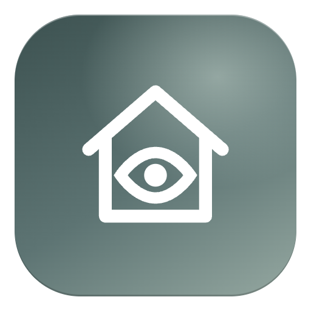
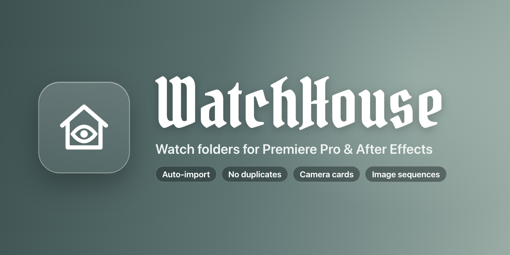
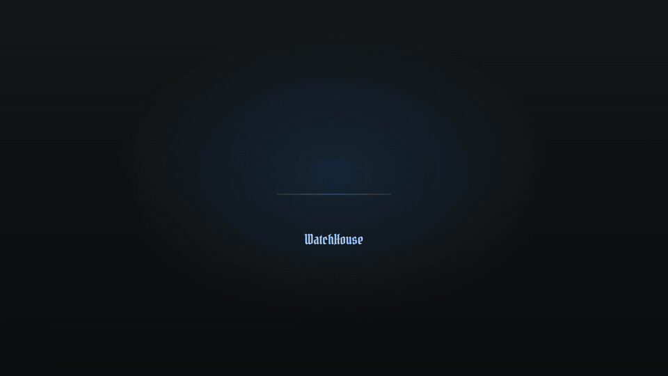
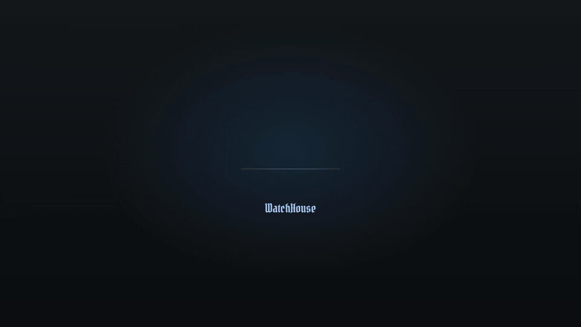
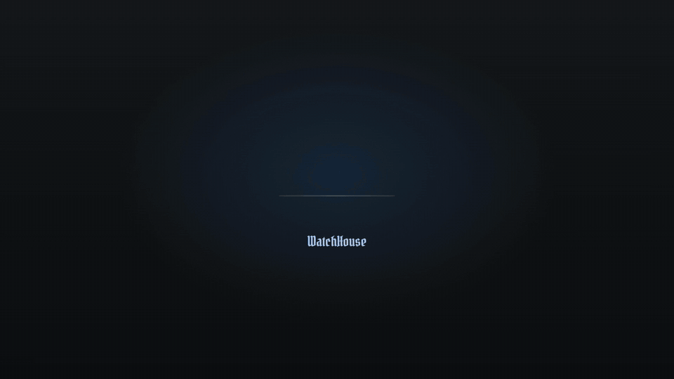

<p align="center">
  
</p>

<h1 align="center">WatchHouse</h1>

<p align="center">
  Watch folders for Premiere Pro and After Effects.<br>
  Drop a file into a folder – it lands in your project, in the right bin.
</p>

<p align="center">
  <b>English</b> · <a href="README.de.md">Deutsch</a>
</p>

<p align="center">
  <a href="https://github.com/Richard2007-21/WatchHouse/releases/latest/download/WatchHouse.zip"><b>Download</b></a>
  &nbsp;·&nbsp;
  <a href="https://github.com/Richard2007-21/WatchHouse/releases">All versions</a>
  &nbsp;·&nbsp;
  <a href="CHANGELOG.md">Changelog</a>
</p>

<p align="center">
  
  
  
  
  
</p>

<p align="center">
  
</p>

## How it works

**1. Link a folder.** Drag a folder from Finder or Explorer onto the WatchHouse panel.
**2. Start auto-sync.** One click.
**3. Done.** New files land in the matching bin, and new subfolders become bins. Nothing is imported twice. You can close the panel; WatchHouse keeps watching in the background.

<p align="center">
  
</p>

WatchHouse waits until a file is completely copied or rendered, and image sequences keep growing in the project while they render:

<p align="center">
  
</p>

Camera cards are detected. Only the clips go into the project, flat in one bin:

<p align="center">
  
</p>

## Installation

### macOS

1. Download [**WatchHouse.zip**](https://github.com/Richard2007-21/WatchHouse/releases/latest/download/WatchHouse.zip) and unzip it.
2. Double-click **Install WatchHouse.command**.
   macOS may say the file is from an unidentified developer: right-click it, choose **Open**, then **Open** again.
3. Restart Premiere Pro or After Effects.
4. Open **Window › Extensions › WatchHouse**.

Prefer the Terminal? In the unzipped folder run:

```bash
./scripts/install-mac.sh
```

### Windows

1. Download [**WatchHouse.zip**](https://github.com/Richard2007-21/WatchHouse/releases/latest/download/WatchHouse.zip) and unzip it.
2. Double-click **scripts\install-windows.cmd**.
3. Restart Premiere Pro or After Effects.
4. Open **Window › Extensions › WatchHouse**.

> [!NOTE]
> **Why an install script?** WatchHouse is a free extension and not signed through Adobe's paid program. Adobe apps only load unsigned extensions when the setting `PlayerDebugMode` is on. The script turns it on and copies WatchHouse to the Adobe extensions folder:
> macOS `~/Library/Application Support/Adobe/CEP/extensions/WatchHouse`,
> Windows `%APPDATA%\Adobe\CEP\extensions\WatchHouse`.

### Uninstall

- macOS: `./scripts/uninstall-mac.sh`
- Windows: delete the folder `%APPDATA%\Adobe\CEP\extensions\WatchHouse`

Your project settings stay where they are.

## Using WatchHouse

**At the top of the panel**

| | |
|---|---|
| 🇩🇪 DE / 🇬🇧 EN | Switch the language |
| ? | Help |
| ⚙ | Settings |
| ☰ | More commands |

**Main view**

| | |
|---|---|
| Status card | Shows whether auto-sync is on and when the last sync ran |
| **Start / Stop auto-sync** | Import new files automatically (saved per project) |
| **Sync now** | Check all folders once |
| **Manage folders** | Add, remove and configure folders |
| Drop zone | Drag in more folders at any time, or click it |
| Watched folders | All linked folders; offline folders are marked |
| History | What was imported last |

**Options per folder** (in *Manage folders*)

| Option | Meaning |
|---|---|
| SUB | Import subfolders too |
| REL | Store the path relative to the project – for project templates and Mac ↔ Windows |
| SEQ | Import numbered images as one image sequence (detected automatically) |
| FLT | Flatten subfolders into one bin (automatic for camera cards) |
| Color | Color label for the bin and new clips, e.g. whooshes green, drone shots blue |

A setting on a folder applies to all its subfolders, also to new ones. Click a folder's path to relink it when it is offline.

## Features

**Watching**
- Auto-sync in the background, also with the panel closed and with several projects open
- Matches files by path against the whole project, so nothing is imported twice – also files you imported by hand
- Waits until a file is completely written: copies, renders, downloads, iCloud files
- New subfolders become bins automatically

**Media**
- Image sequences are detected (3+ digits, 3+ frames in a row) and keep growing while they render
- Camera cards: Sony a7S, Sony FS/XAVC, AVCHD, Canon XF, Panasonic P2, XDCAM-EX, XDCAM-HD, Sony HDV, RED, ARRIRAW, DCIM
- Allowed file types and ignored folders (name or `/regex/`) in the settings

**Premiere Pro**
- Optional *Import Date* metadata column
- Skip the import dialog for Photoshop and Illustrator files
- Messages in the Events panel

**After Effects**
- Project folders instead of bins
- Photoshop and Illustrator files as footage or composition
- Messages in the Info panel

**Interface**
- English and German, switch with the flags at the top
- Built-in help, column legend and tooltips

## Where your data lives

| What | Where |
|---|---|
| Settings of a project | `<project>.prproj.watchhouse.json` or `<project>.aep.watchhouse.json` next to the project file – it travels with project templates |
| General settings | macOS `~/Library/Application Support/WatchHouse/settings.json`, Windows `%APPDATA%\WatchHouse\settings.json` |

## Privacy

WatchHouse collects no data and sends nothing anywhere. It only reads the folders you link and talks to Premiere Pro or After Effects on your computer.

## Good to know

- **Ingest in Premiere:** use *Create Proxies* only. *Copy* and *Transcode* change the file path. WatchHouse tries such a file only once and tells you, instead of importing it again and again.
- **Media Encoder:** let a Media Encoder watch folder render into a WatchHouse folder – new material is converted and imported automatically.
- **After Effects:** save the project first; the settings are stored next to the `.aep`.
- Watch folders must not overlap. A folder inside a watched folder is refused (and the other way round).
- A clip you delete from the project comes back after a restart if the file is still in the folder.

## Build it yourself

```bash
git clone https://github.com/Richard2007-21/WatchHouse.git
cd WatchHouse
./scripts/install-mac.sh --link   # links this folder instead of copying it
npm test                          # tests against a simulated Premiere and After Effects
```

Debug consoles in the browser: Premiere `http://localhost:8094` (panel) and `:8095` (background service), After Effects `:8096` and `:8097`.
A signed `.zxp` can be built with `./scripts/build-zxp.sh` (needs Adobe's ZXPSignCmd).

```
WatchHouse/
├── CSXS/manifest.xml   extension: panel + invisible background service
├── client/             panel and background service
├── lib/                core.js (scanning), engine.js (auto-sync), i18n.js (texts)
├── host/               ExtendScript for Premiere Pro and After Effects
├── tests/              tests with a simulated Premiere and After Effects
└── scripts/            install, uninstall, ZXP build
```

## License

MIT, see [LICENSE](LICENSE). `client/CSInterface.js` is Adobe's CEP library under Adobe's own terms. The title font in the images is [Pirata One](https://fonts.google.com/specimen/Pirata+One) (SIL Open Font License).

WatchHouse is an independent project and is not affiliated with Adobe.
